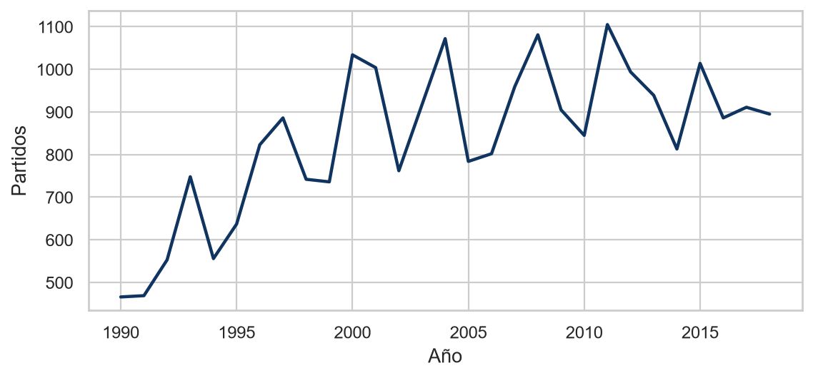
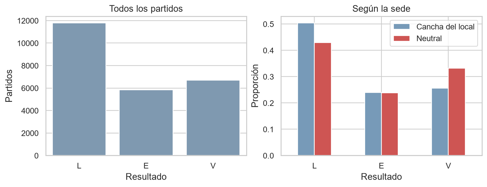
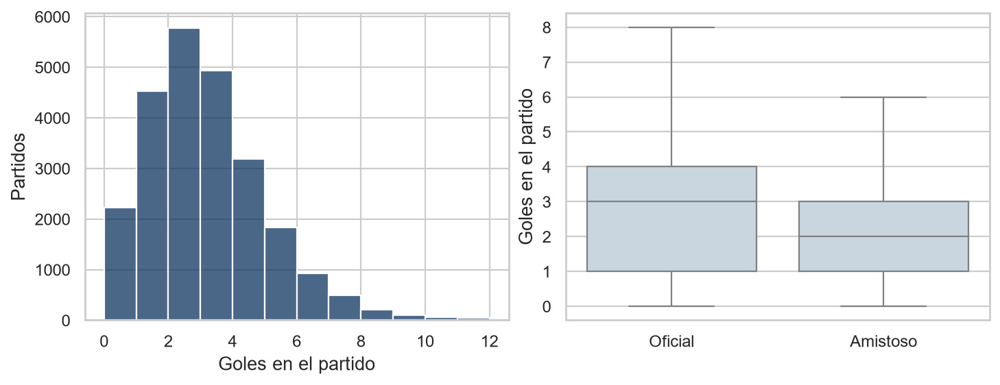
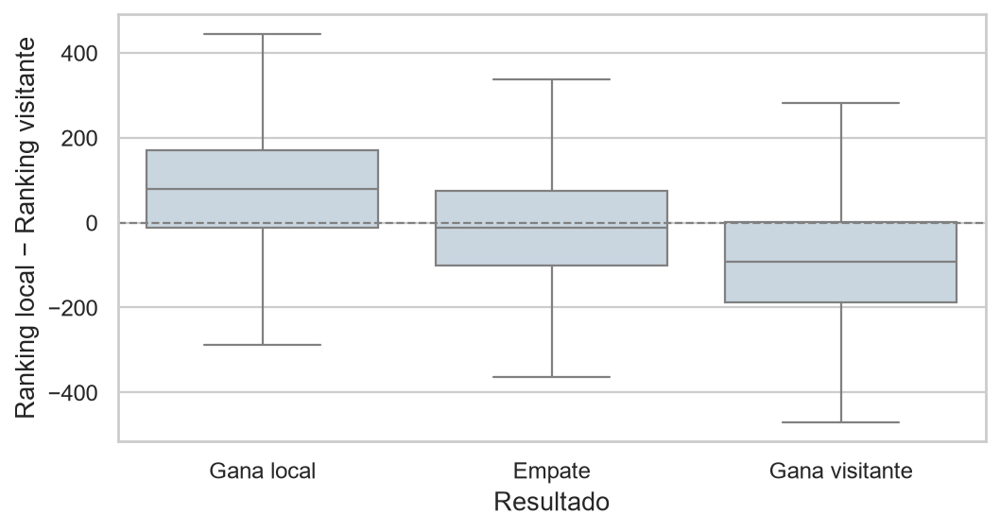
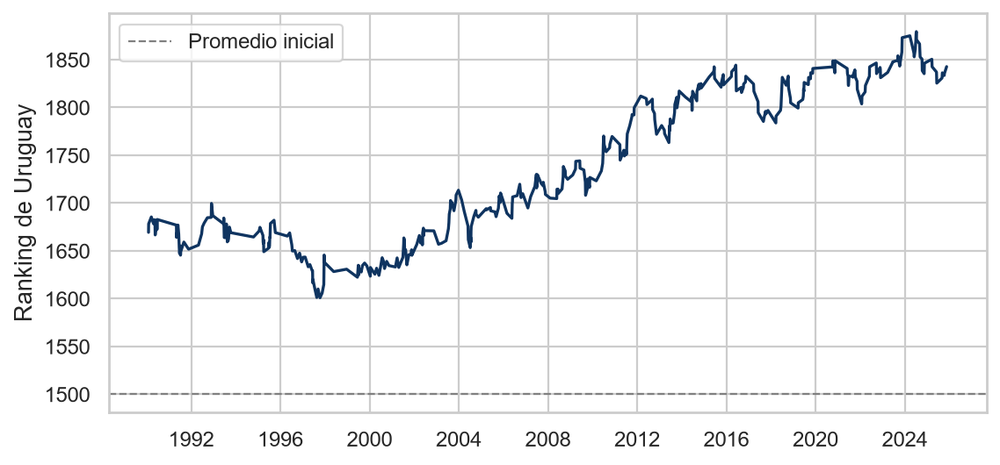
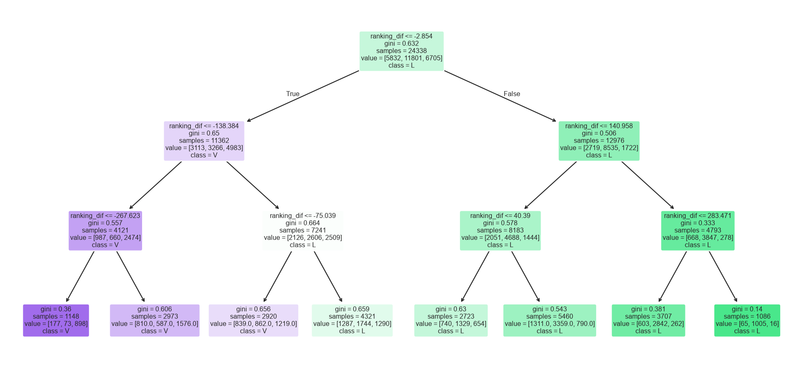
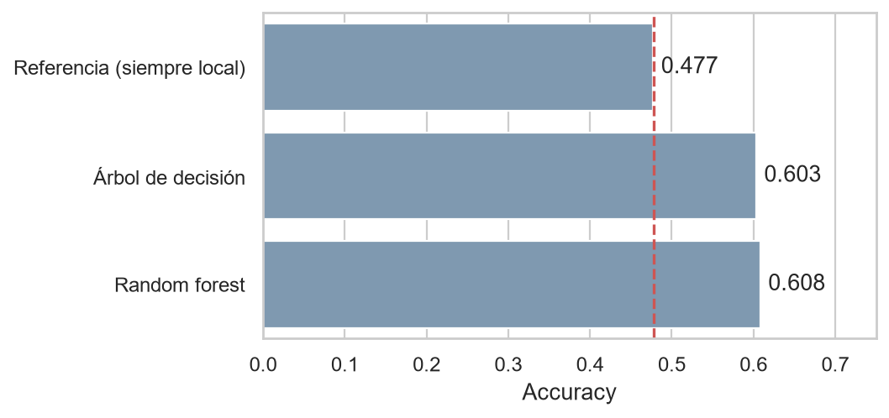
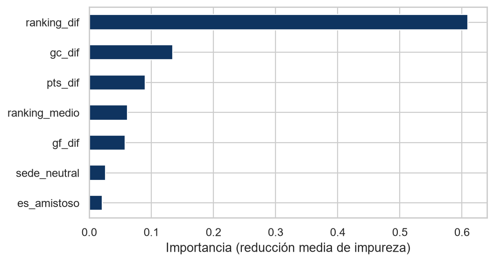
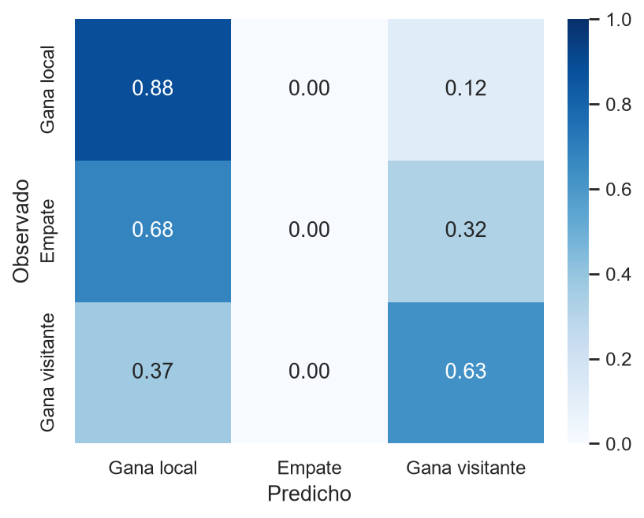

## {.corte background-color="#0F3460"}

::: {style="text-align:center"}
[La pregunta]{style="font-size:0.5em; letter-spacing:4px; color:#F0A202; text-transform:uppercase"}

<h2 style="margin-top:20px">¿Cuánto se puede saber de un partido<br>**antes** de que empiece?</h2>

[Gana el local · Empate · Gana el visitante]{style="font-size:0.7em"}
:::

## Los datos

::: {.tarjetas}
::: {.tarjeta}
[49.144]{.n}[partidos]{.t}
:::
::: {.tarjeta .c}
[153]{.n}[años: 1872 → 2025]{.t}
:::
::: {.tarjeta .v}
[275]{.n}[selecciones]{.t}
:::
::: {.tarjeta .a}
[0]{.n}[faltantes y duplicados]{.t}
:::
:::

::: {.caja}
**Kaggle** · *International football results*, de Mart Jürisoo · licencia CC0

Nueve columnas: fecha, equipos, goles, torneo, sede y si la cancha es neutral.
:::

## El problema

::: {style="font-size:0.9em"}
De los goles sale **lo que queremos predecir**:
:::

```python
partidos["resultado"] = np.select(
    [partidos["home_score"] > partidos["away_score"],
     partidos["home_score"] == partidos["away_score"]],
    ["L", "E"],
    default="V",
)
```

::: {.caja .mal}
Pero entonces **no podemos usar los goles para predecir**. Sería hacer trampa.

Nos quedan nueve columnas… y siete ya se usaron.
:::

## {.corte background-color="#E94560"}

::: {style="text-align:center"}
<h2>La idea:<br>no mirar el partido,<br>**mirar el pasado**</h2>
:::

## Un ranking que armamos nosotros

::: {.tarjetas}
::: {.tarjeta}
[1500]{.n}[arrancan todas iguales]{.t}
:::
::: {.tarjeta .c}
[K = 20]{.n}[máximo que se mueve]{.t}
:::
::: {.tarjeta .v}
[+60]{.n}[ventaja de local]{.t}
:::
:::

::: {.caja}
El ganador le saca puntos al perdedor. **Cuántos depende de qué tan esperable era.**

1800 contra 1500: si gana el fuerte suma **3**. Si pierde, se lleva **−17**.
:::

::: {.pie}
Es el sistema Elo, creado por Arpad Elo para el ajedrez.
:::

## El código {.smaller}

```{.python code-line-numbers="|3-4|7-9|12-14"}
for p in partidos.itertuples(index=False):

    ranking_local = ranking.get(p.home_team, 1500.0)
    ranking_visita = ranking.get(p.away_team, 1500.0)

    # Guardamos el estado ANTES de jugar
    filas.append({"ranking_local": ranking_local,
                  "ranking_visita": ranking_visita,
                  "pts_local": np.mean(prev_local[-5:]), ...})

    # Recién ahora miramos el resultado
    esperado = 1 / (1 + 10 ** (-(ranking_local - ranking_visita + ventaja) / 400))
    ajuste = K * (real_local - esperado)
    ranking[p.home_team] = ranking_local + ajuste
```

::: {.caja .ok}
Primero **leemos**, después **actualizamos**. Ningún partido usa su propio resultado ni el futuro.
:::

## ¿Funciona?

::: {.columns}
::: {.column width="45%"}
| Selección | Ranking |
|---|---:|
| Argentina | 1995 |
| España | 1987 |
| Francia | 1929 |
| Brasil | 1922 |
| Colombia | 1908 |
| **Uruguay** | **1831** |
:::
::: {.column width="55%"}
::: {.caja .ok}
**Nunca le dijimos quién era bueno.**

Todas arrancaron en 1500. Este orden salió solo, de procesar 49.144 partidos en orden cronológico.
:::
:::
:::

## {.corte background-color="#16A085"}

::: {style="text-align:center"}
<h2>Qué encontramos<br>en los datos</h2>
:::

## El fútbol creció

{fig-align="center" width="78%"}

::: {.pie style="text-align:center"}
De 466 partidos en 1990 a **1105 en 2011**. Los picos son los años de Mundial y Eurocopa.
:::

## La localía existe {.smaller}

{fig-align="center" width="80%"}

::: {.caja}
En cancha propia el local gana el **50%**. En cancha neutral, el **43%**.

Esos 7 puntos se los lleva casi enteros el visitante: pasa del 26% al 33%.
:::

## Los goles, y un outlier

{fig-align="center" width="80%"}

::: {.caja .mal}
Lo normal son **2 goles**. El récord de la muestra es un **Australia 31 – 0 American Samoa** de 2001, por eliminatorias.
:::

## La figura que lo explica todo

{fig-align="center" width="68%"}

::: {.pie style="text-align:center"}
Gana el local: venía **+83** de ranking. Gana el visitante: **−102**. Empate: **−14**, justo en el medio.
:::

## Uruguay

{fig-align="center" width="78%"}

::: {.pie style="text-align:center"}
Mínimo en 1997 · sube desde 2007 · máximo en **2024**, con 1860 puntos.
:::

## {.corte background-color="#0F3460"}

::: {style="text-align:center"}
<h2>Modelado</h2>
:::

## Cortamos por fecha, no al azar

::: {.columns}
::: {.column width="50%"}
::: {.tarjeta}
[24.338]{.n}[entrenamiento · 1990–2018]{.t}
:::
:::
::: {.column width="50%"}
::: {.tarjeta .c}
[6.839]{.n}[evaluación · 2019–2025]{.t}
:::
:::
:::

::: {.caja .mal}
Si mezcláramos los años, el modelo podría **entrenar con 2020 para predecir 2010**.

Es justo lo contrario de lo que queremos.
:::

## Tres modelos {.smaller}

```{.python code-line-numbers="|1-2|4-5|7-12"}
# 1. Referencia: predecir siempre la clase más frecuente
clase_mas_comun = y_train.value_counts().index[0]

# 2. Árbol de decisión
arbol = DecisionTreeClassifier(max_depth=3, random_state=42).fit(X_train, y_train)

# 3. Random forest, con los hiperparámetros elegidos por validación cruzada
grilla = GridSearchCV(
    RandomForestClassifier(n_estimators=200, random_state=42),
    param_grid={"max_depth": [4, 6, 8, 12], "min_samples_leaf": [5, 20, 50]},
    cv=5,
).fit(X_train, y_train)
```

## El árbol solo mira una cosa

{fig-align="center" width="88%"}

::: {.pie style="text-align:center"}
Tres niveles disponibles, **tres cortes por `ranking_dif`**. Y ninguna hoja predice empate.
:::

## Resultados

{fig-align="center" width="76%"}

::: {.caja .ok}
**+13 puntos porcentuales** sobre la referencia.

Entre el árbol y el bosque, casi nada: 0.603 contra 0.608.
:::

## ¿Y quién hizo el trabajo?

| Variables | Accuracy |
|---|---:|
| Referencia (siempre local) | 0.477 |
| Solo contexto (sede + amistoso) | 0.477 |
| Contexto + forma reciente, **sin ranking** | 0.540 |
| Solo `ranking_dif`, **una columna** | 0.604 |
| Todas las variables | 0.608 |

::: {.caja}
El contexto solo **no aporta nada**. El ranking solo es **casi todo el modelo**.
:::

## Lo mismo, visto por el bosque

{fig-align="center" width="76%"}

::: {.pie style="text-align:center"}
`ranking_dif` se lleva el **61%** de la importancia.
:::

## {.corte background-color="#E94560"}

::: {style="text-align:center"}
<h2>Dónde falla</h2>
[Y es más interesante que dónde acierta]{style="font-size:0.75em"}
:::

## El empate es invisible

{fig-align="center" width="52%"}

::: {.caja .mal}
De **1555 empates**, el modelo detecta **6**. En 6839 partidos arriesga un empate 10 veces.
:::

## Por qué, y no es culpa de los datos

::: {.tarjetas}
::: {.tarjeta}
[~50%]{.n}[gana local]{.t}
:::
::: {.tarjeta .a}
[~24%]{.n}[empate]{.t}
:::
::: {.tarjeta .v}
[~26%]{.n}[gana visitante]{.t}
:::
:::

::: {.caja}
El empate **nunca es la opción más probable**, ni en el partido más parejo.

Y el clasificador siempre elige la más probable. Así que nunca lo elige.
:::

::: {.caja .ok}
La salida: trabajar con **probabilidades** (`predict_proba`) en vez de forzar una única respuesta.
:::

## Conclusiones {.smaller}

::: {.tarjetas}
::: {.tarjeta .v}
[61%]{.n}[de acierto]{.t}
:::
::: {.tarjeta}
[48%]{.n}[la referencia]{.t}
:::
::: {.tarjeta .c}
[0.4%]{.n}[de los empates]{.t}
:::
:::

::: {style="margin-top:26px; font-size:0.84em"}
- Sí se puede anticipar, **en parte**. Lo que importa es **quién viene siendo más fuerte**.
- La localía se mide: 50% en casa, 43% en cancha neutral.
- El modelo complejo no ganó nada. **Lo ganaron las variables.**
- Y falla justo en los partidos parejos, que son los interesantes.
:::

## {.corte background-color="#0F3460"}

::: {style="text-align:center"}
<h2>Gracias</h2>

[Juan Apolo · Alen Cukier]{style="font-size:0.8em"}

[github.com/juann1234/proyecto-final-python-cd]{style="font-size:0.55em; color:#F0A202"}
:::
